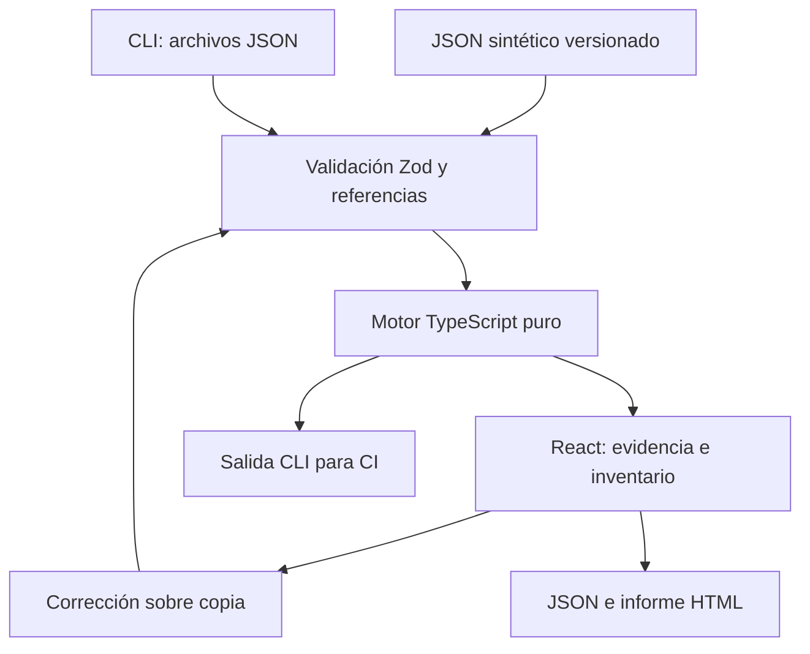

# Arquitectura

`src/engine` no importa React, DOM, red ni reloj. Cada análisis valida otra vez el contrato. La interfaz deriva sus contadores del resultado; no hay puntuaciones de cumplimiento. `src/data/scenarios.ts` es la fuente de los ejemplos JSON. `npm run schema` genera ejemplos y esquema. La CLI acepta los mismos datos y ejecuta el mismo motor.

Las correcciones reciben un ID de hallazgo y comprueban que siga vigente, clonan la entrada, cambian la copia y validan el resultado. La interfaz vuelve a analizar. El rol de mínimo privilegio es exclusivo: nunca se edita un rol compartido. Al reiniciar se clona el original. Cambiar de escenario descarta la copia anterior. No hay persistencia entre recargas.

La exportación JSON incluye las dos entradas completas y las dos evaluaciones. El HTML escapa los datos y no incluye scripts. No hay subida de datos, telemetría, fuentes remotas ni almacenamiento de credenciales. La publicación estática sirve los mismos ficheros a todos. La aplicación no protege un sistema externo.
